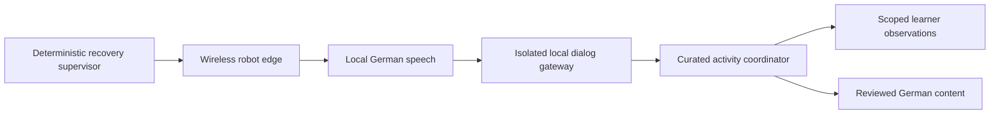

# Architecture and scope

The initial target is a German-speaking learning companion for preschool play,
stories, curiosity, counting, sound/letter games, and discussion of drawings.
Use caregiver-selected activities and narrow observations. Do not infer an
intelligence, emotion, psychological, or health score from interaction data.

## Boundaries

The robot daemon owns hardware. One adapter owns the media/motion session.
Avoid generic SDK construction as a health probe: released SDK v1.13.0 sets
automatic body yaw and initializes media in its constructor. Reconstruct only
a tested narrow transport while preserving mute/camera/motion settings.

The child-session gateway must explicitly select local model endpoints and have no
hosted fallback. Separate credentials, state, and process/filesystem boundaries
from general-purpose host services. A tool allowlist or a different database key
alone is not an authorization boundary. The scaffold does not create a live gateway
profile or modify any installed service.

Keep child speech, images, prompts, transcripts, learner state, logs, and backups
inside the approved local processing boundary. Audit allowed LAN services too:
their workers, proxies, telemetry, or fallbacks can independently send traffic.
URL validation here only checks configuration syntax and address classes.

Start learner continuity with narrow structured local records. Introduce semantic
memory retrieval only through an isolated local instance/API or demonstrated
server-side authorization. A shared unauthenticated memory API can expose child
facts to unrelated host services. Trusted human administrators remain privileged.

## Adaptation

The activity coordinator owns invitations, prompts, clarification, feedback,
optional continuation, and ending. A local model may rephrase within that plan.
Repeat harmless reviewed activities without new approvals. Material changes to
goals, content, model, or permissions belong to caregiver controls.

No self-modifying code or general child-triggered web/plugin access is needed.
Maintenance scripts inspect public project sources and redacted service metrics,
never live session audio or transcripts. This project does not implement
babysitting or a safety-critical monitoring service.

## Recovery

`RecoveryController` atomically reserves a bounded attempt and stores only
action/fault/reason metadata. It does not call an SDK or execute a restart.
Hardware/privacy/identity latches block recovery and play. Output invalidation
and stop remain independent of storage/clock availability; the caller must
actually stop audio/motion through a commissioned path.

Ordinary child refusal is not a fault latch. Repeated failure needs a persistent
budget and a trusted verified-recovery reset. A new session or expired rate
window must not create an endless repair loop. Parent authorization flags in
the library consume a trusted caller's decision; they are not authentication.

## Readiness

The current runnable path is simulation text plus a read-only health service.
ASR, TTS, models, vision, robot media, durable learner observations, and dialog
gateway transport are deliberately unconnected adapter boundaries. Each needs
implementation and the concrete checks in [commissioning.md](commissioning.md).
